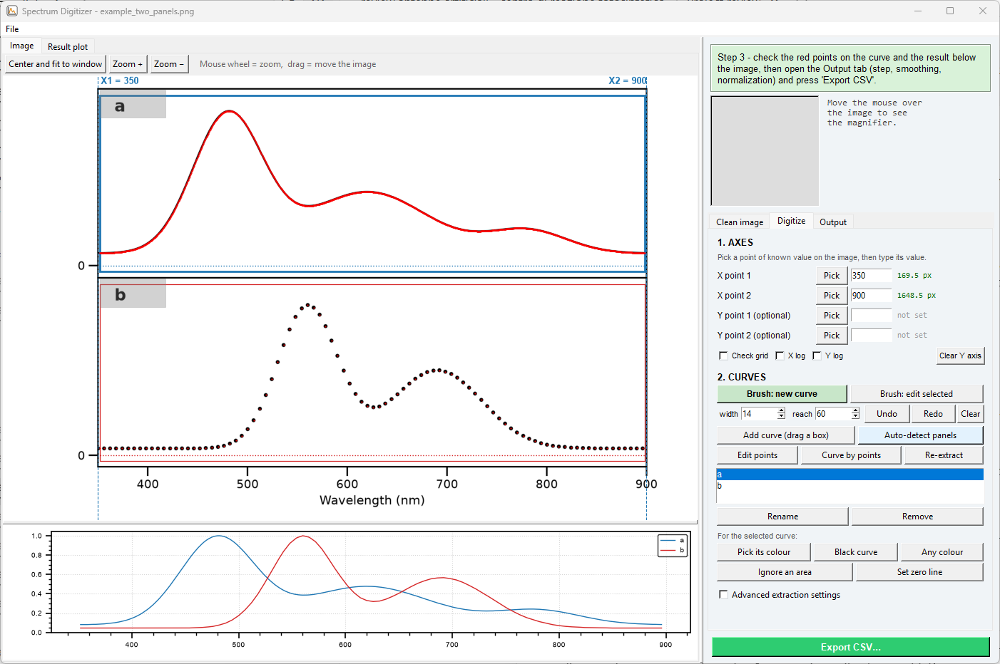
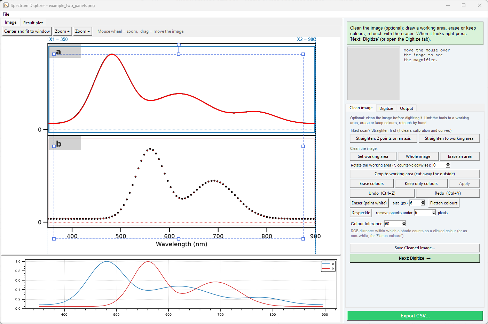
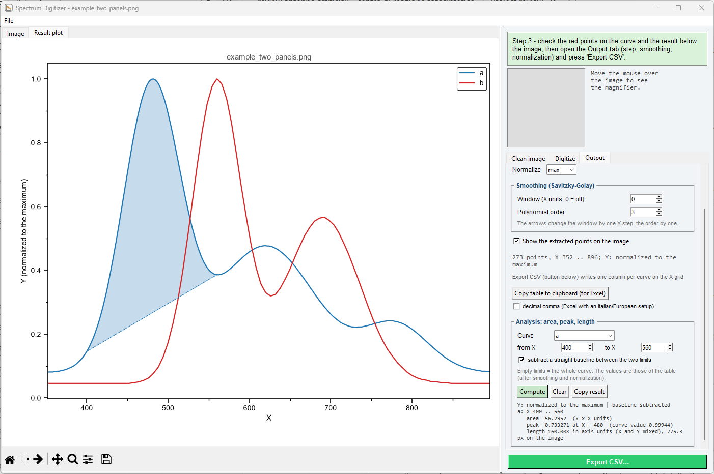

# SpectrumDigitizer

Turns an **image of a spectrum plot** (PNG/JPG, e.g. a figure from a paper or an old printout) into
numbers: a CSV with one column per curve on a regular X grid, ready to be opened in
[LabSpectrumManager](https://github.com/milanone/LabSpectrumManager) (File → Open Files) or any other
tool.



The **Digitize** tab on the synthetic test figure in `examples/` (a continuous curve above a dotted one) after
*Auto-detect panels*: the red points are the extracted curves, and the plot under the image is the resulting data,
normalized to the maximum.



The **Clean image** tab: the working area (dashed, with handles to move, resize and rotate it) limits the colour tools,
the eraser, despeckle, straighten and crop.



The **Output** tab with the large result plot: the shaded band is the area of curve *a* above a straight baseline
between 400 and 560, with its numbers in the Analysis box. (All three screenshots are taken from the real program by
`examples/make_screenshots.py`.)

## Workflow

The panel on the right has three tabs, *Clean image*, *Digitize* and *Output*, and always says what to do next, and a magnifier follows the mouse so that points
can be placed precisely (it also shows the pixel and, once calibrated, the X/Y value under the cursor).

- **Move around the image:** mouse wheel = zoom, drag = move (the image follows the mouse); *Center and fit to window* (or `Home`) shows the whole image centred. These
  never interfere with the tools below. `Esc` cancels the tool that is waiting for a click.
- **Open the image** (File → Open Image, drop it on the window, or pass it on the command line). File → Close Image clears the image, calibration and curves. 
- **Sessions** (File → Open Session / Save Session / Save Session As, `Ctrl+O` / `Ctrl+S`, or drop a `.sdsession`
  file on the window): one file with the image as it is now (after any crop, rotation or cleaning), the axis
  calibration, the curves with their boxes, colours, zero lines, ignored areas and brush paths, the working area
  and all the settings; opening it re-extracts the curves, so the result is the same. The undo/redo history is not
  kept. It is a zip (`session.json` + `image.png`), so it can be inspected with any zip tool.
- **Tab 'Clean image' (optional, first).** Prepares the picture before digitizing: everything here edits the image itself, every step can be undone with *Undo*, and *Save Cleaned Image* (also under File) writes the result as a PNG to open again later: lossless (the pixels are exactly the ones on screen), 8-bit RGB, the size in pixels of the image shown (so after a crop or rotation it is the new size), zlib compression level 9 and the dpi of the source file when it had one; the status box reports the size and the file size. *Next: Digitize* goes on to the second tab. The *Colour tolerance* box is the RGB distance within which a shade counts as a clicked colour.
  - *Straighten* (first, for a tilted scan): *Straighten: 2 points on an axis* — click two points, as far
    apart as possible, on a line that should be horizontal (the X axis, a frame edge) or vertical, and the
    whole image is rotated to make it so (white corners). *Straighten to working area* — draw a working
    area, turn it with the round handle until it follows the plot frame, then press it: the image is rotated
    by the opposite angle. Pixel positions change, so calibration and curves are cleared (it asks first);
    *Undo* restores the image. This replaces tilted-axis calibration: the axes are straight afterwards.
  - *Set working area* — drag a box (shown dashed blue, only in this tab); the colour tools act only inside it.
    *Whole image* removes it. The area has handles, like a shape in a drawing program: drag inside it to
    move it, drag a square handle on a corner or an edge to resize it (the opposite side stays put), drag the
    round handle above the top edge to rotate it (Shift = steps of 15°); the *Rotate the working area* box
    (degrees, counter-clockwise) gives the exact angle, for tilted scans. Move the image itself with the
    right or middle mouse button while the area is shown.
  - *Crop to working area* — cuts the image down to the working area, so the part outside the figure is gone
    (a rotated area is cut to its bounding box and what is outside the area itself becomes white). The pixel
    positions change, so calibration and curves are cleared (it asks first); *Undo* restores the image.
  - *Erase colours* / *Keep only colours* — click a pixel of the trace, or drag a small box over it to take
    all the colours inside the box (best for curves drawn with slightly different shades); repeat if
    needed (selections are marked in magenta), then press *Apply*: every pixel within the colour tolerance
    of any selected colour is painted white, or every pixel that is not of those colours. *Undo* restores
    the previous state. Where another curve of the same colour crosses the erased one it gets a gap.
  - *Eraser (paint white)* — a brush for the final touches: drag over what must go; the circle shows the
    size (*size (px)* box, diameter in image pixels). Each stroke is one *Undo* step. Esc ends.
  - *Flatten colours* — turns every non-white pixel (further from white than the colour tolerance) of the working
    area, or of the whole image, into black: a trace of mixed shades becomes one colour that the default
    detection follows, and the saved cleaned image is uniform. *Undo* restores.
  - *Despeckle* — removes the specks of a scan: groups of non-white pixels (8-connected, further from white
    than the colour tolerance) smaller than the chosen number of pixels, inside the working area. A curve is one
    big group and stays; raise the size to remove larger specks, but keep it below the size of the dots of a
    scatter plot.
  - *Undo / Redo* (`Ctrl+Z` / `Ctrl+Y`) — step back and forward through the image edits; a new edit ends the redo
    history. In the Digitize tab the same keys undo and redo the brush edits (the *Undo* / *Redo* buttons beside
    the brush width).
  - *Erase an area* — drag a box over a legend or a panel letter: it is painted white for all curves
    (*Undo* restores it). Do this first, so the legend is never mistaken for part of a spectrum.
- **Tab 'Digitize'.** The steps below.
- **Figures for a paper (PlotStyleKit).** The result plot has the Origin look of
  [PlotStyleKit](https://github.com/milanone/PlotStyleKit) (Arial, full box, outward ticks, no grid) and the File menu has
  *Save Figure Image (PNG, PDF, SVG)...*, *Save Figure (pickle)...* and *Edit Figure...*: the figure is redrawn at the
  publication size (9 x 6.75 cm, 300 dpi) without a title and handed to the PlotStyleKit editor or to a file. PlotStyleKit is
  optional: the program looks for it next to itself (`../PlotStyleKit`), in `~/progetti/PlotStyleKit`, in the folder the
  environment variable `PLOTSTYLEKIT` names, or in the folder you chose the last time. If it is not found the program says so
  at start and asks for the folder, with *Cancel* for going without (it will not ask again; *File > PlotStyleKit...* changes
  that). Without it the plot keeps a plain matplotlib look, *Save Figure* writes the figure as drawn (no preset size, no
  restyling), and *Edit Figure* offers to locate PlotStyleKit.
- **Check grid.** In the Digitize tab, *Show check grid on the image* draws round-valued lines of the calibration over the image (X always, Y when it is calibrated), labelled with their values: if they do not meet the plot's own ticks, the calibration is off.
- **1. Axes.** Press *Pick* next to *X point 1*, click a tick of known value, then type its value in the
  box; do the same for *X point 2* on a tick far from the first. The Y axis is optional (see below).
  Reversed axes (e.g. FTIR wavenumbers) work. A point can be re-picked at any time. **Logarithmic axes:** tick *X log* and/or
  *Y log* (next to *Check grid*) before or after picking the points; the two values of that axis must then be positive,
  and the position between them is read on a log scale (the value under the cursor in the magnifier too). On a
  logarithmic X axis the output grid is regular in decades: the Output tab asks *X points per decade* instead of the X step,
  and the smoothing window is in decades; the curves are interpolated and smoothed in log10 of the value, so a decay
  over several decades is not distorted. The result plots use log axes. The check grid shows 1, 2, 5 times powers of ten.
- **Fine-tuning with the keyboard:** after picking a point (or setting a zero line) the arrow keys move
  it by 1 pixel (`Shift` = 0.2 pixel): ← → for X points, ↑ ↓ for Y points and zero lines. Clicking in a
  value box selects that point for the arrows; the selected point is drawn in orange. The magnifier
  follows the point being moved.
- **2. Curves.** Two ways to make a curve. The first is the **brush**, for curves that cross others or run close
  to them: *Brush: new curve*, then drag along the curve. You do not need a steady hand: stop whenever you
  like and resume by starting a new drag at an end of the path (the ends are drawn as small circles); where
  the path strays, drag that stretch (not its end) back onto the curve and the neighbouring points follow
  smoothly (*reach* = how far along the path, in pixels; hold `Shift` to pull an end instead of resuming
  it). The path is smoothed, the translucent corridor around it (*width*, in pixels, a little wider than the
  line) is where the curve is looked for, and the colour to follow is chosen for you: the ink colour under the path (dark pixels, or that colour, which keeps crossing curves of other colours out), or *Any colour* when that single colour would find the curve in fewer than 80 % of the columns under the brush (a curve that changes colour along its way, or is pale in places, would otherwise stop early and come out as a broken line; the status box says so if it still happens). The brush stays
  active until `Esc`; *Brush: edit selected* goes back to a curve's path, *Undo brush* takes back the last
  edit, *Clear* drops the path. Axes, frame and grid lines are removed from the corridor like in the box mode (they are looked for in the whole image, so a curve falling onto the x axis is not replaced by the axis; a flat curve you trace on purpose is kept). Where a curve merges into the axis line it cannot be told apart and the points stop there. The
  second way is *Add curve* with a drag box around one curve that has its own space, leaving out axis
  labels, legends and panel letters. Repeat for each curve. For the selected curve:
  - *Pick its colour* — click on the curve to extract only pixels of that colour (several coloured
    curves in the same box, coloured lines over a grid...). *Black curve* goes back to dark pixels.
    *Any colour* takes every non-white pixel in the box as the curve (for a trace of mixed shades: black, violet,
    pink... after cleaning the image); the *Colour tolerance* is then how far from white
    a pixel must be (lower it, e.g. to 15, to follow a very pale tail).
  - *Edit points* — corrects the extracted points of the selected curve by hand where the automatic extraction goes
    wrong. Drag a point to move it; `Shift`+drag pulls its neighbours along with a smooth falloff (*reach* = how far
    along the curve, the same box as for the brush); click on empty space to add a point; drag a box over empty
    space to delete the points inside it; `Ctrl`+click, or select a point (click) and press `Delete`, removes one.
    `Esc` ends. A curve edited this way keeps its points when the parameters change (it is no longer recomputed);
    *Re-extract* gives the edits up. *Undo / Redo* (`Ctrl+Z` / `Ctrl+Y` in this tab) go through them.
  - *Curve by points* — makes a curve out of clicks alone (nothing is extracted): for a curve the program cannot see
    at all. Y is then the height above the bottom of the image unless the Y axis is calibrated or a zero line is set.
  - *Ignore an area* — drag a box over something inside the curve's box that must be skipped (a
    panel letter, a legend: they show up as spikes in the result plot).
  - *Set zero line* — click the zero level of the curve (only used without a Y calibration).
  - Rename (also by double-click) or Remove.
- **Tab 'Output'.** X step and normalization, and the *Smoothing* box (window and polynomial order), act live on the result plot. The numbers have up/down arrows (here and in the other tabs: tolerance, thresholds, brush width) (also the arrow keys, and press-and-hold): the X step walks 0.1, 0.2, 0.5, 1, 2, 5, 10..., the smoothing window moves by one X step, the polynomial order by one. The left pane has two views, *Image* and *Result plot*: under the image there is a small preview (drag the boundary to resize it), and the *Result plot* view shows the digitized curves large, with axis labels, a legend and the matplotlib toolbar (zoom, pan, *save as image*). Opening the Output tab switches the left pane to the Result plot, the other tabs switch it back to the image; the views can also be chosen by hand. *Show the extracted points* toggles the red dots on the image. *Export CSV* (the green button, always visible) writes one column per curve. *Copy table to clipboard (for Excel)* puts the same table on the clipboard as tab-separated text (File → Copy Table to Clipboard too); the *decimal comma* box writes ',' instead of '.', which an Italian/European Excel needs to take the numbers as numbers (it starts ticked when the system's number format uses the comma). The *Advanced extraction settings* (dark threshold, colour tolerance, single-dot size) are at the bottom of the Digitize tab. **Analysis** (box at the bottom of the tab): area, peak and length of one curve, or of all of them, between two X values
  (empty = the whole curve; the limits need not be on the grid, they are interpolated). The values are those of the table, so
  smoothing and normalization count. *Compute* switches it on: the numbers are updated whenever the result changes and the
  integrated area is shaded on the result plot; *subtract a straight baseline between the two limits* gives the peak area
  above the line joining the curve's values at the limits; *Copy result* puts the text on the clipboard, *Clear* stops it. The
  area is the trapezoid integral of Y dX in the units of the axes (without a Y calibration: pixels or the normalized height).
  The length is the sum of the segments in axis units (X and Y mixed, so it is only meaningful with comparable units) and, in
  pixels, on the image.

**Auto-detect panels** is a shortcut for framed, Origin-style figures with one or more stacked
panels: it finds the frame, creates one curve per panel, calibrates X from the left/right frame edges
(you type the two X values), finds each panel's zero tick and hides the panel letter.

### Y values

- With a **Y calibration** (two clicks on the Y axis), ordinates are calibrated values. It is global:
  use it for single-panel figures.
- **Without it**, ordinates are the height in pixels above the trace's zero line (the zero tick found
  by *Auto-detect panels*, the one set with *Set zero line*, or the bottom of the box). Use
  *Normalize → max* to get a 0-1 scale per curve.

### Output

Comma-separated CSV, UTF-8, first column `X`, then one column per trace (named after the trace), on a
grid of multiples of the chosen step; cells are empty where a trace has no data (more than two pixels
outside its curve). LabSpectrumManager reads it with its generic CSV reader; for X values above 2000 it
treats the spectra as FTIR.

## Limits

- One curve per box: for overlapping curves of the same colour, draw one box per curve where they
  are separate, or distinguish them by colour. Curves that cross are not separated.
- The box does not have to be tight: frame lines, ticks outside the frame and a panel letter inside the
  box are ignored automatically (a row or column that is dark over 70 % of the box is taken for a
  ruling line, and where several blobs give a point at the same X the one that continues the curve is
  kept). The flip side: a **perfectly flat curve** covering more than 70 % of the box width is read as a
  ruling line too; draw the box around the part that is not flat.
- Each X position gets one point per curve (the centroid of its pixels): vertical segments of a curve
  are reduced to their midpoint, and the result is limited by the image resolution (about ±1 pixel).
- Linear and logarithmic axes, each axis independently (checked on synthetic plots: a 3-decade decay and a log X sweep, errors of about one pixel). Anti-aliased/JPEG images work in principle; very low-resolution or heavily
  compressed ones give noisy curves (raise the smoothing).
- Dotted curves: dots are recognised by size (*Max dot size*); dots touching each other are treated
  as a continuous line.
- **Verified only on the synthetic test figure in `examples/`** (the whole workflow, with real mouse events
sent to the window: zoom, pan, axis points, boxes, ignoring an area, Y calibration, export): on it, the extracted curves match the
  data they were drawn from to within 0.2 % of the panel height on average (peak positions to 1 nm
  over a 550 nm axis). It has **not** been tried yet on figures from real publications, scans or
  JPEGs: if one fails, send the image.

## Requirements and run

```
pip install -r requirements.txt
pythonw SpectrumDigitizer.pyw [image]
```

`SpectrumDigitizer.ico` is the window and taskbar icon (drawn by `examples/make_icon.py`); the program runs without it.

Python 3 with Tkinter, numpy, scipy, Pillow, matplotlib; `tkinterdnd2` is optional (drag and drop).

## Tests

```
python -m unittest discover -s tests -v
```

`tests/test_extraction.py` checks the extraction functions (they do not need a window) on small
drawn images and on `examples/example_two_panels.png`, which `examples/make_example.py` generates
together with its ground-truth data (`example_two_panels_truth.csv`). No real data is used.

## License

MIT — see `LICENSE`.
